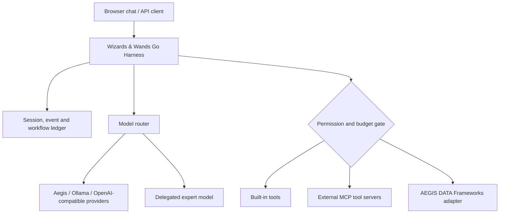

# ✦ NeVeRhOOd Wizards & Wands

### A model-agnostic chat harness, tool control plane and agent workflow runtime

**Real-time AI chat · OpenAI-compatible models · tools · MCP · approval gates · bounded autopilot · subagents · multimodal artifact handling · session replay**

Built by **Henry Barton** for **NeVeRhOOd Academy**. Open-source orchestration for Aegis and other compatible models. **No proprietary model weights, private execution paths, account credentials or cloud provisioning included.**

[](https://github.com/tooljhlb/NeVeRhOOd-aegis-Wizards-Wands/actions/workflows/verify.yml) · [MIT License](LICENSE) · [Sponsor development](https://github.com/sponsors/tooljhlb)

## The control plane for your AI

Wizards & Wands is a **working local application** for selecting models, maintaining conversations, streaming tokens, routing tool calls through human approval gates, delegating bounded tasks, and building multi-model DAG workflows. A native Go HTTP server serves the browser interface and also provides a subset of the OpenAI Chat Completions API.

It does **not** supply a trained model, GPU inference engine, browser automation service, or magic access to other people's cloud accounts. It connects to independently running compatible model providers and MCP tool servers you configure.

### Quick start — zero external dependencies

Requires **Go 1.23+**.

```bash
git clone https://github.com/tooljhlb/NeVeRhOOd-aegis-Wizards-Wands.git
cd NeVeRhOOd-aegis-Wizards-Wands
go test ./...
go run .
```

Open **http://127.0.0.1:8787**. The server prints a randomly generated **temporary local API token** in the terminal. Paste that token into the connection dialog. The default `demo` profile runs offline and can exercise chat, time tools and session persistence. It is a functional harness demo, **not a real reasoning model**.

For a stable token and custom models:

```bash
cp config.example.json config.json
export WW_TOKEN='REPLACE_WITH_A_LONG_RANDOM_SECRET'
go run . -config config.json
```

Never commit `config.json` or provider credentials. Environment variables provide tokens to model and MCP adapters.

### Connect Aegis, Ollama, LM Studio, vLLM, or cloud models

The harness speaks to compatible **`POST /v1/chat/completions`** endpoints. Example entries for a local Ollama or LM Studio server are in [config.example.json](config.example.json). Change the profile's model ID to one actually available on that endpoint. An Aegis runtime can use the same interface if it exposes compatible chat-completion semantics.

```json
{
  "name": "aegis-local",
  "provider": "openai-compatible",
  "base_url": "http://127.0.0.1:8000/v1",
  "model": "aegis"
}
```

For a cloud endpoint, use HTTPS and set the `api_key_env` field to the **name** of your existing secret environment variable. Model differences in streaming, tool calling, reasoning-effort support and multimodal content must be verified per provider.

## Functional components

| Area | Included in v0.1 |
| --- | --- |
| Chat | SSE token streaming; model-provided optional reasoning deltas; session history; model picker |
| Modes | Chat, assisted, autopilot, research, engineering, media; bounded tool/autonomy policies |
| Tools | Restricted calculator, UTC time, safe HTTPS text fetch, artifact inspection, specialist delegation, Aegis DATA read-only adapter |
| MCP | Configurable Streamable HTTP `tools/list` + `tools/call` client, named tool catalog, explicit safe-tool allowlists and approval gates |
| Subagents | Bounded specialist delegation to a second configured model; separate multi-model workflow DAG |
| Workflows | Validated dependencies, sequential execution, model-per-stage selection, progress events, durable outcomes |
| Media | Local artifact upload/metadata for video, audio, image and other files; actual generation/decoding via external adapters |
| Storage | Local atomic session/workflow snapshots, event replay and persisted tool-result records |
| Compatibility | Subset of `/v1/chat/completions` and `/v1/models`; JSON and SSE responses; no server-side tool execution in stateless compatibility mode |
| Interface | Dark desktop/mobile UI with sessions, composer, approvals, tool registry and activity feed |

### Architecture



**Wizards = specialists and workflows. Wands = typed tools.** Aegis DATA Frameworks is an independent backend, not a copied subdirectory. The public Aegis DATA repository is [here](https://github.com/tooljhlb/NeVeRhOOd-aegis-DATA-Framworks). This parent harness can connect to a public or private DATA instance via its authenticated local API.

## Connect your tool stack

The included [connector catalog](catalog/connectors.json) documents 23 common tool ecosystems, including GitHub, GitLab, Hugging Face, Drive, Gmail, Figma, Vercel, Replit, browser automation and analytics services. **These are integration templates**, not live or preauthorized accounts. Attach an independently authorized MCP endpoint to use a connector; see [MCP configuration and permissions](docs/CONNECTORS.md).

A local DATA Frameworks adapter supports **read-only** capability discovery and acceptance coverage. Running arbitrary jobs or modifying DATA evidence is not implicitly authorized.

## API example

```bash
curl http://127.0.0.1:8787/v1/chat/completions \
 -H "Authorization: Bearer $WW_TOKEN" \
 -H 'Content-Type: application/json' \
 -d '{"model":"demo","messages":[{"role":"user","content":"Hello"}],"stream":false}'
```

For managed streaming chat, create a session using `POST /api/sessions` and send to `POST /api/sessions/{id}/chat`. See [the API and architecture reference](docs/ARCHITECTURE.md).

## Trust, scope and tests

- Tools that are not declared safe pause for an explicit **approve/deny** response before execution; autopilot is not blanket permission.
- Workflow/model budgets are finite; nested tool execution is not enabled for delegated specialist agents.
- The built-in web fetcher blocks private/reserved IPs, redirects and untrusted URL schemes, and never runs JavaScript.
- File attachments are locally stored, 16 MiB maximum. Generation and playback of video/music require external services and real codec tooling.
- MCP support covers tool discovery/calls over Streamable HTTP, **not complete MCP conformance** or imported ChatGPT plugin access.
- `go test -race ./...`, `go vet ./...` and a Go build passed during development. The published GitHub Actions workflow independently checks the public revision; inspect its status rather than assuming it passed.

[Security and trust model](docs/SECURITY.md) · [Workflows](docs/WORKFLOWS.md) · [Architecture](docs/ARCHITECTURE.md) · [Connectors](docs/CONNECTORS.md)

### What's next

Native multimodal adapters; stdio MCP and full protocol handling; browser sandbox adapters; persistent job queue and pause/resume; parallel agent graphs; scoped artifact access for adapters; public plugin SDK; observability/export of ProofReceipts and richer Aegis DATA workflows. These are **planned**, not included as finished features in v0.1.

**NeVeRhOOd Academy · Henry Barton · MIT licensed.** Contributions, independent integration tests and sponsorship are welcome.
