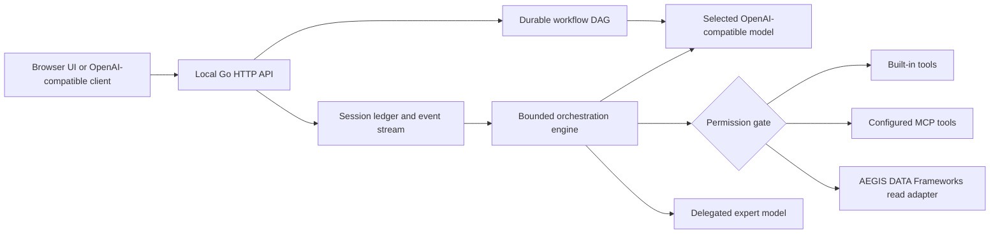

# Architecture and contracts

## Runtime layers

The chat harness is **model-agnostic**: Aegis, Ollama-hosted models, vLLM, LM Studio and supported cloud providers may expose an OpenAI-compatible `POST /chat/completions` endpoint. Compatibility is tested per endpoint; some models reject `tools`, `reasoning_effort`, or streamed tool deltas. Profile selection is explicit; no providers are contacted unless configured.

## Public interfaces

| Route | Purpose | Status |
| --- | --- | --- |
| `GET /healthz` | Process health, no secrets | Implemented |
| `GET /api/status` | Sanitized server status | Implemented |
| `GET /api/models`, `/v1/models` | Model profiles without credentials | Implemented |
| `POST /v1/chat/completions` | Stateless OpenAI Chat Completions subset, JSON/SSE | Implemented |
| `POST /api/sessions` | New persistent conversation | Implemented |
| `GET /api/sessions`, `/api/sessions/{id}` | Sessions and transcript | Implemented |
| `POST /api/sessions/{id}/chat` | Token/tool/reasoning SSE events | Implemented |
| `POST /api/sessions/{id}/approval` | Resume paused tool batch with decision | Implemented |
| `GET /api/sessions/{id}/events?after=N` | Ordered stored-event replay | Implemented |
| `POST /api/workflows/execute` | Dependency-validated model-agent workflow | Implemented |
| `GET /api/workflows`, `/api/workflows/{id}` | Workflow receipts and progress | Implemented |
| `GET /api/tools`, `/api/connectors` | Runtime tools/configuration discovery | Implemented |
| `POST /api/artifacts` | Bounded local file ingest with digest | Implemented |
| `GET /api/artifacts/{id}` | Metadata or authenticated download | Implemented |

Every API route except `/healthz` and static UI assets requires `Authorization: Bearer $WW_TOKEN` or `X-WW-Token`. Default binding is loopback. Stateful chat SSE uses named events (`turn.started`, `content.delta`, `reasoning.delta`, `tool.started`, `approval.required`, `tool.completed`, `turn.completed`, errors). Each event has an incremental ID. A completed turn persists messages and the event record atomically. A reconnecting client may replay from `GET .../events?after=N`; there is **no claim of transparent live SSE reattachment after disconnection**.

The stateless `/v1/chat/completions` endpoint **does not execute tools**. It forwards model outputs and tool calls, leaving execution to its client. Use the session chat endpoint for the managed tool loop.

## Operational policies

- Chat and assisted modes have a conservative tool approval gate. Autopilot can run built-in read-only tools and explicitly trusted MCP tools without approval; all other MCP tools require approval even in autopilot.
- Tool iterations are capped by `max_steps` (1–16). Model-returned tool batches are capped at eight calls.
- Declared model agents can be delegated one bounded task through `delegate_agent`, without recursive tool access. Workflow DAG steps are separately bounded and have **no** tool access in v0.1.
- Session snapshots and workflow state use atomic write/rename. A crash during a stream may lose uncommitted deltas; complete turns persist. An interrupted workflow is marked `interrupted` when loaded rather than fabricated as complete.
- Artifacts are stored by SHA-256 and capped at 16 MiB through the HTTP upload endpoint. Audio/video bytes are retained; **codec, transcription, generation and playback depend on external adapters**.
- MCP client implements a constrained `tools/list` and `tools/call` Streamable HTTP subset with configurable 2026-07-28 or legacy 2025-06-18 versions. It does not implement the full MCP protocol, stdio transport, subscriptions, OAuth orchestration or media handling.

## Source design derivation

The design reimplements the useful architecture concepts from an earlier private Wizards & Wands prototype: Wizard/Wand registries, typed chat messages, event buses, approval policies, task DAGs, session management and replay. None of the original code or its private dependencies is shipped here. The public implementation is stand-alone Go with no mandatory third-party packages.
